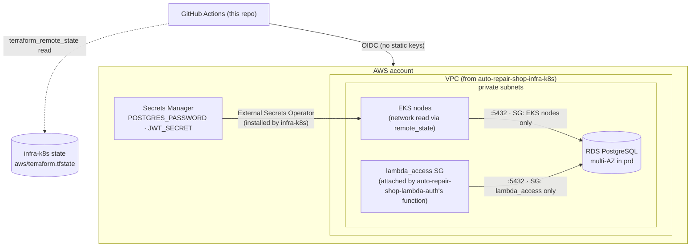

# auto-repair-shop-infra-db

Terraform for the managed database (AWS RDS PostgreSQL) used by the
[auto-repair-shop](https://github.com/POS-FIAP-15SOAT-TEAM-DARK-MODE/auto-repair-shop)
application. Split out of the app's monorepo as part of a move to
independently deployable services, each with its own CI/CD.

This repository provisions **only** the data stores — the RDS PostgreSQL
instance (one database per service, see [ADR 0005](docs/adr/0005-one-rds-instance-database-per-service.md))
and the DynamoDB table of the History service (see [ADR 0006](docs/adr/0006-dynamodb-for-history.md)).
It does not create or duplicate any networking. It reads the VPC, private subnets and the EKS node
security group from the
[auto-repair-shop-infra-k8s](https://github.com/POS-FIAP-15SOAT-TEAM-DARK-MODE/auto-repair-shop-infra-k8s)
repo's `aws` state via `terraform_remote_state`, so the cluster must be
provisioned (or at least its `aws` layer applied) before this state can apply.

## Technologies

- Terraform (>= 1.10), AWS provider (~> 6.0), `terraform-aws-modules/rds/aws`
- AWS: RDS (PostgreSQL 15), DynamoDB, Secrets Manager, Security Groups, CloudWatch (dashboard)
- GitHub Actions (OIDC — no long-lived AWS keys)

## Structure

Two Terraform states, one per layer, plus the database bootstrap Job:

```
terraform/                 # layer "db" (state key db/terraform.tfstate)
├── versions.tf            # backend (S3) + providers
├── variables.tf
├── locals.tf              # per-environment sizing (stg/prd), derived from the workspace
├── remote_state.tf        # reads VPC/subnets/node SG from auto-repair-shop-infra-k8s
├── rds.tf                 # RDS instance, its SG, legacy secret ${name}/app (kept until F10)
├── secrets.tf             # per-service DB credentials and secrets (see below)
├── dashboard.tf           # CloudWatch dashboard (CPU, memory, connections)
├── lambda_access.tf       # SG auto-repair-shop-lambda-auth attaches its function to
└── outputs.tf
terraform/dynamodb/        # layer "dynamodb" (state key dynamodb/terraform.tfstate)
├── versions.tf            # backend (S3), provider, optional MiniStack endpoint override
├── main.tf                # history table auto-repair-shop-<env>-history
└── outputs.tf
db-bootstrap/              # Kubernetes Job run after `apply` of layer db
├── bootstrap.sh           # idempotent: roles, databases, lambda read-only grants
└── job.yaml               # Job db-bootstrap in namespace auto-repair-shop
docs/                      # ERDs per database, ADRs
```

The state bucket is the **same** S3 bucket created once by
`auto-repair-shop-infra-k8s`'s `bootstrap` state
(`auto-repair-shop-tfstate-<account_id>`), under different keys
(`db/…`, `dynamodb/…`) so the states never collide.

## Databases, roles and secrets

One RDS instance (`auto-repair-shop-<env>-db`) holds one database and one login
role per service (ADR 0005). The `db-bootstrap` Job creates them; the table
below is the contract with the services (`contracts/resources.md` of the umbrella
repo `auto-repair-shop`, `docs/fase4/`).

| Service | Database | Login role | Secret in Secrets Manager |
|---|---|---|---|
| Customer & Identity | `customer` | `customer_app` | `auto-repair-shop-<env>/customer` |
| Catalog | `catalog` | `catalog_app` | `auto-repair-shop-<env>/catalog` |
| Billing | `billing` | `billing_app` | `auto-repair-shop-<env>/billing` |
| Execution | `execution` | `execution_app` | `auto-repair-shop-<env>/execution` |
| Service Order | `service_order` | `service_order_app` | `auto-repair-shop-<env>/service-order` |
| Customer-login lambda | `customer` (read only) | `lambda_auth_ro` | `auto-repair-shop-<env>/lambda-auth` |
| History | — (DynamoDB) | — | `auto-repair-shop-<env>/history` (`JWT_SECRET`) |

- JSON keys of each secret are the environment variable names the service reads
  (`POSTGRES_USER`, `POSTGRES_PASSWORD`, `POSTGRES_DB`, `JWT_SECRET`, and
  `INTERNAL_TOKEN` for the services that use it).
- `JWT_SECRET` is the same value everywhere (`random_password.jwt`), so tokens issued
  before this change stay valid.
- The legacy secret `auto-repair-shop-<env>/app` is untouched and is removed only
  when the monolith is retired (F10).
- `REVOKE CONNECT … FROM PUBLIC` on every database: each role connects only to its own.

### Bootstrap Job

`db-bootstrap/bootstrap.sh` runs as the Job `db-bootstrap` (`postgres:15-alpine`).
For each service it creates the login role (if missing), re-syncs its password
with Secrets Manager, grants the master user membership of the role (needed on RDS
to set `OWNER`) and creates the database. Then it grants `lambda_auth_ro` read
access to the `customer` database, including tables created later by the
`customer_app` migrations (default privileges). Re-running it changes nothing.

The infra workflow runs it after `apply` of layer `db`: it builds a Secret
`db-bootstrap` (master password from `auto-repair-shop-<env>/app`, service
passwords from their secrets), applies the ConfigMap and the Job, waits for
completion and prints the logs. The Secret is deleted at the end of the step, even on failure.

## Local checks

- Terraform: `terraform fmt -check -recursive terraform`,
  `terraform -chdir=terraform init -backend=false && terraform -chdir=terraform validate`,
  and the same for `terraform/dynamodb`.
- DynamoDB against MiniStack (the same as the `dynamodb-ministack` CI job):
  ```bash
  docker run -d --rm -p 4566:4566 --name ministack ministackorg/ministack
  export AWS_ACCESS_KEY_ID=test AWS_SECRET_ACCESS_KEY=test AWS_DEFAULT_REGION=us-east-1
  terraform -chdir=terraform/dynamodb init -backend=false
  terraform -chdir=terraform/dynamodb apply -auto-approve -var aws_endpoint=http://localhost:4566
  aws --endpoint-url http://localhost:4566 dynamodb describe-table --table-name auto-repair-shop-stg-history
  ```
- Bootstrap against a local Postgres (run twice: the second run must succeed with the same result):
  ```bash
  docker run -d --rm -p 5432:5432 -e POSTGRES_PASSWORD=masterpw postgres:15-alpine
  export PGHOST=localhost PGUSER=postgres PGPASSWORD=masterpw PGSSLMODE=disable \
    PW_CUSTOMER=… PW_CATALOG=… PW_BILLING=… PW_EXECUTION=… PW_SERVICE_ORDER=… PW_LAMBDA=…
  sh db-bootstrap/bootstrap.sh && sh db-bootstrap/bootstrap.sh
  ```
  Passwords are arbitrary local values; never commit real ones.

  Verified on 2026-11-02 against `postgres:15-alpine` (real server, not a mock): both runs ended with exit 0
  (the second only prints `already a member` notices), each database is owned by its service role, and
  `catalog_app` connecting to the `customer` database is refused (`User does not have CONNECT privilege`).
  `terraform plan` of the `shared`, `messaging` and `aws` stacks is not covered here: it needs AWS credentials
  and runs only in the GitHub Actions workflow.

## Deploy — driven from GitHub Actions

No AWS tooling is needed on your machine; applied via GitHub Actions (OIDC).

**Prerequisites:**
1. `auto-repair-shop-infra-k8s`'s `bootstrap` + `shared` states already
   applied (state bucket + GitHub OIDC provider + `terraform` IAM role exist).
2. `auto-repair-shop-infra-k8s`'s `aws` state already applied for the target
   workspace (stg/prd) — this repo reads its VPC/subnet outputs.

**GitHub config** (Settings → Environments):
- `infra` → variable `AWS_TERRAFORM_ROLE_ARN` = the same `terraform_role_arn`
  output used by `auto-repair-shop-infra-k8s` (one IAM role, shared across the
  infra repos, scoped by GitHub OIDC `sub` claim to the `infra` environment —
  update the role's trust policy `github_repo`/`environments` if it needs to
  allow this repo explicitly).

**Provision the database** — run the **Infra (Terraform)** workflow
(`workflow_dispatch`) with `layer=db`, `action=apply` for `stg` and `prd`. Each
run also bootstraps the databases (job `db-bootstrap`). Then run it with
`layer=dynamodb`, `action=apply` to create the History table (order: `db`, then
`dynamodb`; the two are independent). Copy the printed `db_host` into the
`auto-repair-shop` app repo's `RDS_HOST` GitHub Environment variable (STG/PRD).

PRs touching `terraform/**` or `db-bootstrap/**` get an automatic `fmt` +
`validate` of both states, a syntax check of `bootstrap.sh`, and the
`dynamodb-ministack` job (applies the History table against MiniStack). No
credentials are used on PRs.

## Step-by-step walkthrough (AWS Academy Learner Lab)

Follows on directly from `auto-repair-shop-infra-k8s`'s walkthrough — run
that repo's steps 1-5 first (bootstrap + `aws` state applied for `stg`),
then come back here.

1. **Add the same three secrets to this repo**, fresh from your Learner Lab
   session if some time has passed (`AWS_ACCESS_KEY_ID`, `AWS_SECRET_ACCESS_KEY`,
   `AWS_SESSION_TOKEN` — repo-level secrets, not variables):
   this repo → **Settings → Secrets and variables → Actions → Secrets →
   New repository secret**.

2. **Run it.** Actions tab → **"Infra (Terraform)"** → Run workflow (branch:
   this feature branch, until merged) → `environment=stg`, `layer=db`,
   `action=plan` first. It automatically derives the same state bucket
   (`auto-repair-shop-tfstate-<account_id>`) and reads `infra-k8s`'s `aws`
   state from it — no manual wiring needed, as long as step 4 in the
   `infra-k8s` walkthrough already ran successfully. If `plan` looks sane
   (creating an RDS instance, a security group, two Secrets Manager
   resources), re-run with `action=apply`. Takes ~5-10 minutes for `stg`
   (single-AZ `db.t3.micro`).

3. **Grab the output.** Expand "Show outputs", copy `db_host` — you'll set
   this as `RDS_HOST` in the `auto-repair-shop` app repo's `STG` GitHub
   Environment (or just leave it unset: the app's `Docker` workflow
   auto-discovers it by naming convention, `auto-repair-shop-stg-db`, if it
   matches what got created here).

4. Continue in the `auto-repair-shop` app repo: set the `STG` environment's
   AWS secrets, then run/push to trigger the `Docker` workflow to build,
   push, and deploy the app onto the cluster from `infra-k8s`, pointed at the
   RDS instance created here.

## Observability — CPU/memory metrics & dashboard

RDS already publishes its own infra metrics to CloudWatch, no agent to
install. `terraform/dashboard.tf` provisions a CloudWatch dashboard
(`<project>-<env>-rds`) with CPU utilization, freeable memory and connection
count. After apply, get the console link from the `cloudwatch_dashboard_url`
output:
```bash
terraform -chdir=terraform output -raw cloudwatch_dashboard_url
```

Cluster/pod-level CPU (EKS nodes) is covered separately by
`auto-repair-shop-infra-k8s`'s kube-prometheus-stack (Prometheus + Grafana).

## Local development

There is no local environment for the RDS layer. The DynamoDB layer and the
bootstrap script can be checked locally against MiniStack and a Postgres
container, as described in "Local checks" above. For ad hoc `terraform plan`
against a real AWS account, install `terraform` and the `aws` CLI locally.

## Swagger / Postman

Not applicable — this repository provisions infrastructure only, no HTTP API
of its own.

## Architecture



Why PostgreSQL is [ADR 0003](docs/adr/0003-postgresql-as-the-database-engine.md);
the current entity-relationship model with relationship explanations is
[docs/database-erd.md](docs/database-erd.md).

## Related repositories

- [auto-repair-shop](https://github.com/POS-FIAP-15SOAT-TEAM-DARK-MODE/auto-repair-shop) — the application that connects to this database
- [auto-repair-shop-infra-k8s](https://github.com/POS-FIAP-15SOAT-TEAM-DARK-MODE/auto-repair-shop-infra-k8s) — the cluster + VPC this database is placed into
- [auto-repair-shop-lambda-auth](https://github.com/POS-FIAP-15SOAT-TEAM-DARK-MODE/auto-repair-shop-lambda-auth) — attaches its function to the `lambda_access` security group created here to reach this RDS instance
