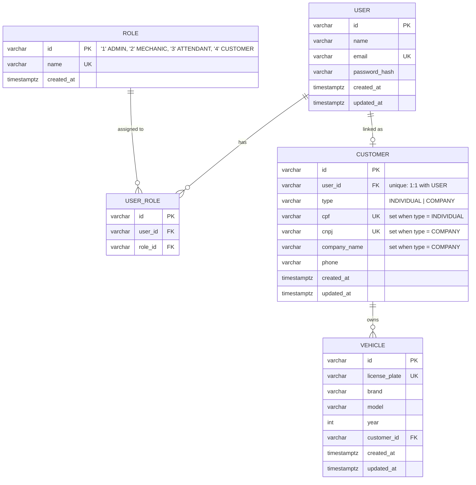
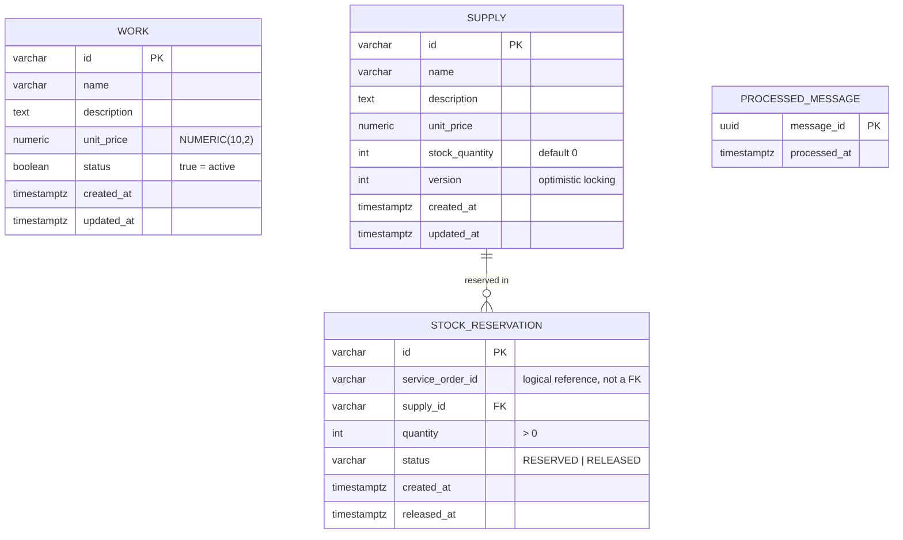
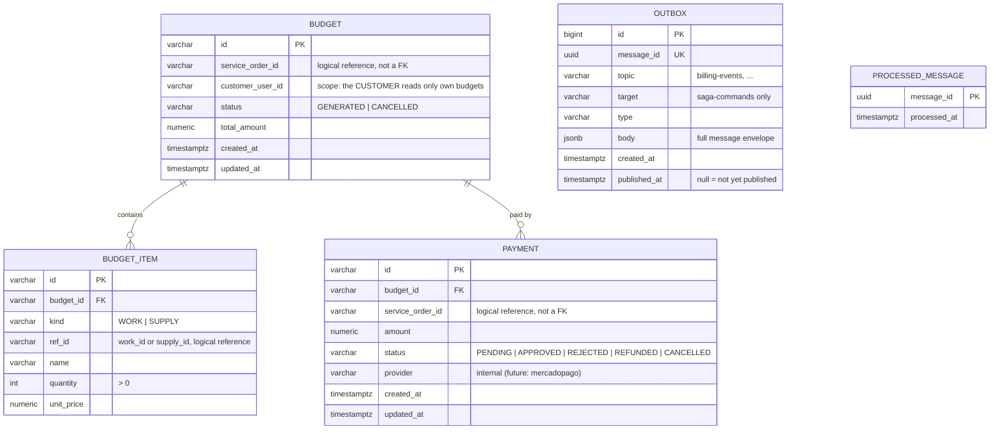

# Entity-relationship model (one model per database)

Each service owns its database (see [ADR 0005](adr/0005-one-rds-instance-database-per-service.md)),
so there is one diagram per database. They are derived from the DDL contract in
`docs/fase4/contracts/ddl.md` of the umbrella repository. The shared
`processed_message` and `outbox` tables are described once, below.

There are **no foreign keys across databases**. Columns such as
`service_order_id`, `customer_user_id` or `budget_item.ref_id` are logical
references: they are validated by the services over HTTP or messages, never by
the database.

The single-schema diagram of the monolith (before the split) is in the git
history of this file.

## `customer` — Customer & Identity (`customer_app`)

Tables `"user"`, `role`, `user_role`, `customer` and `vehicle` are copies of the
monolith's `000001_init_schema`. `work`, `supply` and the service-order tables are
not in this database.

- `USER` ↔ `CUSTOMER` is 1:1 and optional on the `USER` side: staff accounts
  (ADMIN, MECHANIC, ATTENDANT) have no `CUSTOMER` row.
- The customer-login lambda (`lambda_auth_ro`) reads this database only:
  `customer.cpf` → `customer.user_id` → roles through `user_role`.
- The physical table name of `USER` is `"user"` (quoted, a reserved word).

## `catalog` — Catalog (`catalog_app`)

- `UNIQUE (service_order_id, supply_id)` on `STOCK_RESERVATION`: a reservation is
  re-activated (`RELEASED` → `RESERVED`) instead of duplicated.
- Stock is decremented and returned in the same transaction as the reservation row.
- `WORK` and `SUPPLY` are separate, as in the monolith (only `SUPPLY` has stock).
- Catalog consumes messages and does not publish, so it has no `OUTBOX`.

## `billing` — Billing (`billing_app`)

- Partial unique indexes enforce the business rules: one `GENERATED` budget per
  service order, and one open payment (`PENDING` or `APPROVED`) per service order.
- Payment transitions: `PENDING → APPROVED | REJECTED | CANCELLED`, `APPROVED → REFUNDED`.
  A refund request on a final state is ignored (idempotent) and the event is published once.

## `execution` and `service_order`

Not yet specified in `ddl.md` (the DDL contract covers `customer`, `catalog` and
`billing` so far). Their diagrams will be added when the contract is written.

## `history` — History & Reporting (DynamoDB)

Not a relational database. It is one DynamoDB table,
`auto-repair-shop-<env>-history`, defined in `terraform/dynamodb/`
(see [ADR 0006](adr/0006-dynamodb-for-history.md)).

| Key | Attribute | Type |
|---|---|---|
| Partition key | `PK` | S |
| Sort key | `SK` | S |

Billing mode is `PAY_PER_REQUEST`. The item shapes (which `PK`/`SK` patterns
and attributes each event produces) belong to the History service and are not
in the contracts yet. They must be defined there before the model can be drawn.
